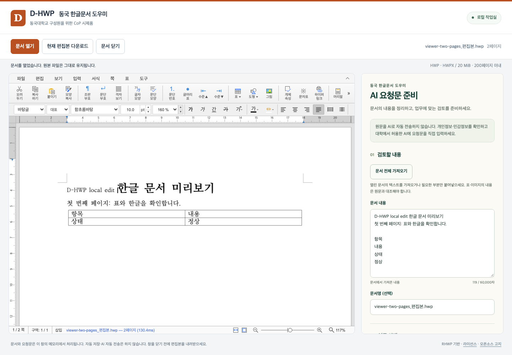

# D-HWP · 동국 한글문서 도우미

**한글 문서를 열고, 편집하고, AI 업무 검토를 준비하는 작업실.**

동국대학교 구성원의 문서 업무 개선을 위한 개발 시제품입니다. [RHWP for Slack](https://github.com/postmelee/rhwp-slack)을 포크했으며, [rhwp](https://github.com/edwardkim/rhwp)의 core/editor/Studio **0.8.7** 고정 조합을 기반으로 합니다. 학교 공식 서비스·배포를 뜻하지 않습니다.



## 지금 할 수 있는 일

- **로컬 문서 작업실:** Slack 계정 없이 내 컴퓨터의 HWP·HWPX를 열고 편집합니다. 편집본은 새 파일로 내려받습니다.
- **AI 업무 도우미:** 문서 전체 텍스트를 가져오거나 필요한 부분만 직접 붙여넣습니다. 문서 요약, 공문·문장 교정, 재무·지급 검토 준비, 업무 인수인계에 맞춘 요청문을 만듭니다.
- **확인 후 전달:** 원문과 요청문을 확인하고 복사하거나 Markdown 파일로 저장하여 조직에서 허용한 AI에 직접 전달합니다. 이 버전은 AI API를 호출하거나 답변을 생성하지 않습니다.
- **Slack 편집기:** 원본의 접근권한·새 편집본 저장 흐름에 같은 AI 업무 패널을 추가했습니다. 별도 Slack 앱 설정이 필요합니다.
- **규정 MCP 연동:** 문서 속 규정 인용을 점검하고 관련 조문과 원문 링크를 확인합니다. 필요한 정보를 묻는 재무 검토와 확인한 근거를 포함한 요청문을 지원합니다. [MCP 연결 설정](docs/d-hwp-mcp.md)이 필요합니다.

문서 파일·추출문·요청문을 서버에 자동 전송하거나 브라우저 저장소에 자동 기록하지 않습니다. 로컬 편집은 브라우저 메모리에서 처리합니다. **규정 검토를 명시적으로 실행하면 확인한 텍스트·질문·사실관계가 서버를 거쳐 MCP로 전달됩니다.** 기존 Slack 경로는 변환 서버와 Slack 저장소를 사용합니다.

## 빠른 실행 — 로컬 작업실

Node/npm은 `.nvmrc`와 `package.json`의 버전을 기준으로 맞추고 Python 3을 준비합니다. 최초 빌드는 고정 Studio 소스와 패키지를 내려받기 위한 인터넷 연결이 필요합니다.

```sh
git clone --branch publish/task3 https://github.com/buenosiempre-cmd/d-hwp.git
cd d-hwp
npm ci --ignore-scripts --no-audit --no-fund
npm run desk
```

브라우저에서 **http://127.0.0.1:4175/desk/** 를 엽니다. 이미 빌드했다면 `npm run serve:desk`로 다시 시작합니다. 기본 편집·요청문에는 AI API 키가 필요하지 않습니다. MCP는 [안내](docs/d-hwp-mcp.md)에 따라 `.env.desk.local`에 설정합니다. `publish/task3`은 규정 연동 구현 브랜치이며 선행 `publish/task1`을 포함합니다.

## 사용 흐름

1. HWP/HWPX 파일을 열거나 오른쪽 도우미에 필요한 텍스트를 붙여넣습니다.
2. 문서를 검토·수정한 뒤 **문서 전체 가져오기**를 누릅니다. 부분 범위는 직접 붙여넣습니다.
3. 업무 목적을 고르고 요청문을 만듭니다. 이름·연락처 등 불필요한 정보와 원문 누락을 확인합니다.
4. 요청문을 복사/다운로드해 사용 중인 AI에서 검토합니다. AI 결과는 원문과 적용 규정에 대조합니다.
5. 편집본은 별도 내려받습니다. 자동저장은 없으며, 파일을 닫기 전에 저장 결과를 확인합니다.

텍스트 추출은 표 구조·이미지·서명·각주·쪽 배치를 완전히 보존하지 않습니다. 문서를 변경한 뒤에는 다시 가져오세요. 요청문 생성은 업무 검토 완료나 지급 승인으로 취급하지 않습니다.

## 개발과 검증

```sh
npm run typecheck
npm test
npm run test:slack
npm run test:security
npm run build:desk
npm exec playwright install chromium
npm run test:desk
# 기존 Slack 편집기 회귀 (프로덕션+개발 빌드 포함)
npm run test:viewer
```

- [사용·개발 안내](docs/d-hwp.md)
- [규정 MCP 설정·사용](docs/d-hwp-mcp.md)
- [이번 구현 계획](mydocs/plans/task_m001_1.md)
- [구현·검증 보고서](mydocs/report/task_m001_1_report.md)
- [기반 프로젝트 개발 문서](docs/README.md): upstream 운영 설명이 포함되어 있으므로 D-HWP 실제 배포 설정으로 간주하지 않습니다.

## 지원 범위와 다음 개발

현재 편집기는 파일당 20 MiB·200쪽 범위이며 HWP3·암호화 파일은 지원하지 않습니다. 한컴과 모든 서식·출력이 같다고 보장하지 않으므로 교내 대표 서식으로 열람·수정·저장 후 재열기를 검증해야 합니다.

다음 단계는 교내 서식별 입력 안내, 승인된 AI 서비스 연결, 확인한 수정안의 문서 반영, 사용시간 전후 비교입니다. 실제 Slack 설치·교내 인증·공용 배포·AI 응답 품질·현업 효율성은 별도 검증 대상입니다.

## 출처와 라이선스

RHWP for Slack과 rhwp 원저작권을 유지합니다. 앱 코드의 [MIT License](LICENSE)와 엔진·라이브러리·폰트의 [제3자 고지](THIRD_PARTY_NOTICES.md)를 확인하세요. `site/` 및 기존 배포 문서는 upstream 서비스 자료이며 D-HWP의 운영자·개인정보 처리방침이 아닙니다. D-HWP 작업실은 이 사이트 자료나 원본 운영 화면을 배포하지 않습니다.

버그나 제안은 [D-HWP Issues](https://github.com/buenosiempre-cmd/d-hwp/issues)에 남겨 주세요. 공개 이슈에는 실제 업무 문서·인증정보를 첨부하지 않습니다.
